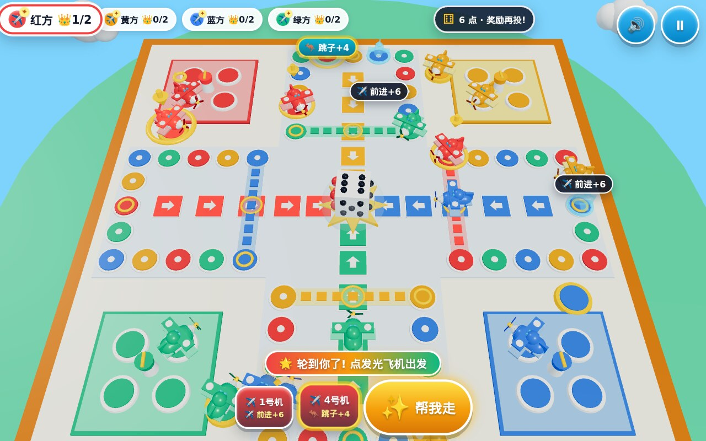

# QQ飞行棋 3D — QQ Aeroplane Chess 3D

**Live Playable URL:** [https://kunruiw1991.github.io/qq-aeroplane-chess-3d/](https://kunruiw1991.github.io/qq-aeroplane-chess-3d/)  
**GitHub Repository:** [https://github.com/kunruiw1991/qq-aeroplane-chess-3d](https://github.com/kunruiw1991/qq-aeroplane-chess-3d)



A 3D WebGL2 remake of Tencent QQ Game Hall's classic **QQ飞行棋 (QQ Aeroplane Chess)** built with Three.js r170, procedural WebAudio synthesis, and a deterministic 60Hz simulation engine designed for both young touch-screen players on iPad and nostalgic desktop players.

---

## Authentic *QQ飞行棋* Features & Ruleset

1. **Classic 3D Cross Sky-Island Board & 16 Chibi Biplanes (`红 / 黄 / 蓝 / 绿`)**:
   - **52-Tile 4-Color Outer Perimeter Loop**: Rounded 3D tiles in Red (`红鹰号`), Yellow (`黄蜂号`), Blue (`蓝鲨号`), and Green (`绿龙号`).
   - **4x6 Colored Home Stretch Corridors (`终点走廊`)**: Glowing directional arrow corridors leading to the Center Star Goal Monument.
   - **4 Corner Hangar Aprons (`机库停机坪`) & Launch Pads (`起飞坪`)**: Each with 4 parking bays, spinning control-tower radar, Trophy Crown pedestals, and exterior Launch Pad.
   - **4 Glowing Dashed Fly-Across Runways (`飞棋航线`)**: Elevated sky-bridges across the board with animated dashed light strips.
   - **16 Bespoke 3D Chibi Toy Biplanes & Tumbling 3D Die**: Multi-part 3D biplanes with spinning 3-blade nose propellers, wings, tailfins, and Chibi QQ Penguin pilots with aviator goggles peeking out of the cockpits (`metalness <= 0.22`), plus a 3D physics-tumbling die inside the center crystal dome.
2. **100% Authentic *QQ飞行棋* Rules**:
   - **Takeoff (`起飞`)**: Rolling `5` or `6` launches a plane from Hangar to its Launch Pad (`relStep = 0`) in default QQ Fast `5/6` mode (or selectable Classic Strict-`6` mode).
   - **Bonus Roll & Triple-`6` Safety Cap (`连投奖励与三连6限制`)**: Rolling `6` grants a bonus roll; rolling three consecutive `6`s triggers the classic safety cap and passes the turn.
   - **Same-Color Jump (`跳棋`, `+4` tiles)**: Landing on an outer-ring tile of your own color (except the Home Stretch entry arrow at `relStep = 50`) hops `+4` tiles to the next same-color tile.
   - **Dashed Fly-Across Shortcut (`飞棋`, `+12` tiles) & Chaining**:
     - Direct landing on the Fly-Across start tile (`relStep = 18`) flies `+12` tiles across the dashed bridge to `relStep = 30` and chains one final `+4` Jump to `relStep = 34` (`Fly -> Jump`).
     - Landing on `relStep = 14` jumps `+4` to `relStep = 18` and immediately chains the `+12` Fly-Across to `relStep = 30` (`Jump -> Fly`).
   - **Mid-Runway Capture (`飞棋撞子`) & Regular Capture (`撞子`)**: Flying across the dashed runway bounces any enemy planes sitting on the intersected center Home Stretch runway tile (`relStep = 53`) or midpoint back to their Hangar with firework VFX; landing on enemy planes on the outer track also sends them back to Hangar.
   - **Friendly Plane Stacking (`叠机`)**: Landing on friendly plane(s) stacks them with a 3D orbiting stack badge (`×2 / ×3 / ×4`).
   - **Exact Goal (`终点到达`) & Overshoot Bounce-Back (`终点反弹`)**: Landing on exact step `56` crowns the plane (`👑`), while overshooting step `56` bounces backward along the Home Stretch by the excess steps.
   - **Modes & Top-3 3D Star Podium**: Supports **Quick 2-Plane Kids Mode (`速战2机`)** and **Classic 4-Plane Mode (`经典4机`)**, **1P vs 3 Smart Tactical AI**, and **2P–4P Pass-and-Play**, finishing on a 3D Top-3 Star Podium (`3/2/1/0` stars).

---

## Controls (iPad Touch & Desktop Keyboard)

- **Touch / Mouse**:
  - Tap the glowing **`🎲 掷骰子`** button to roll.
  - Tap directly on any **gold-highlighted 3D plane** on the board (via 3D raycast) OR tap its quick-pick plane button (`✈️ 1号机..4号机`) in the bottom dock.
- **Keyboard**:
  - `Space` / `Enter`: Roll dice (or move the recommended plane)
  - `1` / `2` / `3` / `4`: Select legal plane `1..4`
  - `P` / `Escape`: Pause / Resume
  - `M`: Mute / Unmute WebAudio BGM & SFX

---

## Changelog — Fun Overhaul (v1.1)

The first release was *correct* but not *fun*: with the 5/6 takeoff rule a player could sit through a
dead first minute (measured: 7 "no moves" rolls in a row), most human turns had a single legal move,
and captures / flights happened without any spectacle. This overhaul fixes the feel:

- **No dead first minute** — `fastStart`: every player begins with one plane on its launch pad and the
  human's very first roll is guaranteed to be a takeoff die (5/6). Across 8 seeded sims the first human
  move now happens at **0.7 s** (was up to 43.7 s) and the longest wait between human actions dropped
  from a median **14.6 s to 6.9 s**; a quick 2-plane game lasts **2–3.7 min**.
- **Snappier pace** — AI think `18f → 6f`, dice tumble `48f → 30f`, hop `12f → 8f` per tile (whole move
  capped at 0.9 s), "no moves" pause `48f → 20f` with a big "没掷到5/6，起飞失败" stamp.
- **Real choices** — legal planes glow and bob, ghost planes preview every destination with an outcome
  badge (💥 击落 / ✈️ 飞棋 / 🦘 跳子 / ⭐ 到家 / ↩ 反弹 / 🛫 起飞), the best move pulses as a hint,
  identical options are merged into one button, and planes (or their ghosts) can be tapped in 3D.
- **Spectacle** — captures trigger 0.35 s slow-mo, a 15 % camera punch-in, "击落!" text and a smoking
  spiral back to the hangar; the 18→30 fly-across is followed by the camera with speed lines and a
  whoosh; crowning fires fireworks and a 3-note fanfare; the centre die is 1.6× larger with a stamp pop.
- **Kid HUD** — "🌟 轮到你了!" banner, a ≥96 px pulsing 掷骰子 button ("✨ 帮我走" when choosing),
  4 plane avatars with the active one enlarged, ≥16 px status pills, ≤5 controls on screen.
- **Hall integration** — writes `localStorage['qq_hall_progress'].aeroplane` (plays / best rank / stars)
  for the QQ Game Hall 3D progress badges.
- E2E suite grown from 36 to 45 tests (pace budgets, fastStart, ghost previews, slow-mo, HUD caps,
  single-row pills, 4-viewport zero-scroll).

---

## Running & Verifying Locally

```bash
python3 -m http.server 18802
# Run the 45-test headless WebGL2 E2E suite:
python3 tests/run_e2e.py
```
